# mapa_simulacion_graphens.md

Ámbito: `src/simulation/` (foco en `phenotype_simulation/` y `gene_phenotype/`), relación con `src/ontology/`.
Rama: `pytorch-study`. Documento generado por inspección estática (AST/grep) + lectura directa de archivos. Sin ejecución de código, sin modificaciones al repo.

---

## 1. Grafo de imports (solo módulos internos `src.*`, generado vía `ast.parse` sobre cada `.py` de `src/simulation/` y `src/ontology/`)

```mermaid
graph TD
  subgraph ontology["src/ontology/"]
    O_init["__init__.py"]
    O_check["check_deprecated.py"]
    O_hpograph["hpo_graph.py"]
    O_updater["hpo_updater.py"]
    O_orphanet["orphanet_mapper.py"]
  end

  subgraph gene_phenotype["src/simulation/gene_phenotype/"]
    GP_init["__init__.py"]
    GP_db["database.py"]
    GP_facade["facade.py"]
    GP_demo["demo.py"]
  end

  subgraph phenotype_simulation["src/simulation/phenotype_simulation/"]
    PS_interfaces["interfaces.py"]
    PS_distributions["distributions.py"]
    PS_selector["selector.py"]
    PS_dataloader["data_loader.py"]
    PS_simulator["simulator.py"]
    PS_factory["factory.py"]
    PS_demo["demo.py"]
    PS_integration["integration_demo.py"]
    PS_ablation["ablation_simulation.py"]
    PS_createds["create_hpo_dataset.py"]
  end

  subgraph simulation_root["src/simulation/ (raíz)"]
    S_analysis["analysis.py"]
    S_analyze_phen["analyze_phenotypes.py"]
    S_translation["translation.py"]
    S_fenoproc["fenotipos_processing.py"]
    S_updatedep["update_deprecated_hpo.py"]
    S_updategold["update_goldstandard_dataset.py"]
    S_keepleaves["keep_leaves_of_goldstandard_dataset.py"]
    S_exampleupd["example_update_deprecated.py"]
  end

  subgraph external["fuera de src/simulation y src/ontology (consumidores externos)"]
    E_srcfactory["src/factory.py"]
    E_graphadj["src/graph/adjacency.py"]
    E_augmentation["src/augmentation/hpo_augmentation.py"]
    E_embedding["src/embedding/* (4 archivos)"]
    E_pipeline["src/pipeline/orchestrator.py"]
    E_visualization["src/visualization/graphviz.py"]
    E_analyzelatent["analyze_gnn_latent_space.py"]
    E_buildvecdb["build_phenotype_vector_db.py"]
    E_convertjson["convert_json_to_graphs.py"]
  end

  O_init --> O_check
  O_init --> O_hpograph
  O_init --> O_updater

  GP_init --> GP_db
  GP_init --> GP_facade
  GP_facade --> GP_db
  GP_demo --> GP_facade
  GP_db --> Core["src.core.types"]
  GP_facade --> Core

  PS_distributions --> PS_interfaces
  PS_simulator --> PS_interfaces
  PS_selector --> PS_interfaces
  PS_selector --> GP_init
  PS_selector --> O_hpograph
  PS_selector --> Core
  PS_dataloader -.->|"sin deps internas"| PS_dataloader
  PS_interfaces --> Core

  PS_factory --> PS_interfaces
  PS_factory --> PS_distributions
  PS_factory --> PS_selector
  PS_factory --> PS_simulator
  PS_factory --> PS_dataloader
  PS_factory --> GP_init
  PS_factory --> O_hpograph

  PS_demo --> PS_factory
  PS_demo --> PS_dataloader
  PS_demo --> GP_init
  PS_demo --> O_hpograph
  PS_demo --> O_updater
  PS_demo --> Core

  PS_integration --> PS_factory
  PS_integration --> O_hpograph
  PS_integration --> O_updater
  PS_integration --> Core

  PS_ablation --> PS_simulator
  PS_ablation --> PS_dataloader
  PS_ablation --> PS_selector
  PS_ablation --> PS_distributions
  PS_ablation --> O_hpograph
  PS_ablation --> GP_init
  PS_ablation --> Core

  PS_createds --> Graphens["src.graphens"]

  S_analysis --> O_hpograph
  S_analysis --> GP_init
  S_analysis --> Core
  S_analyze_phen --> O_hpograph
  S_analyze_phen --> Core
  S_translation --> O_hpograph
  S_translation --> Core
  S_fenoproc --> S_translation
  S_fenoproc --> Core
  S_updatedep --> O_check
  S_updatedep --> GP_facade
  S_updatedep --> GP_db
  S_updategold --> GP_facade
  S_keepleaves --> GP_facade
  S_keepleaves --> O_hpograph
  S_exampleupd --> S_updatedep

  E_srcfactory --> O_hpograph
  E_srcfactory --> O_updater
  E_graphadj --> O_hpograph
  E_augmentation --> O_hpograph
  E_embedding --> O_hpograph
  E_pipeline --> O_hpograph
  E_visualization --> O_hpograph
  E_analyzelatent --> O_hpograph
  E_analyzelatent --> O_orphanet
  E_buildvecdb --> O_hpograph
  E_convertjson --> O_hpograph
```



**Hallazgo del grafo:** `src/ontology/hpo_graph.py` (`HPOGraphProvider`) es el nodo con más in-edges de todo el repo (≥15 importadores, dentro y fuera de `src/simulation/`). Ningún módulo fuera de `src/simulation/phenotype_simulation/` importa ese subpaquete (`grep -rn "phenotype_simulation" --include="*.py" . | grep -v "/phenotype_simulation/"` → sin resultados) — el simulador está desconectado del pipeline de entrenamiento (`training/`, `validation_arena/`), que consume un LMDB ya materializado en disco.

---

## 2. Árbol de llamadas: `SimulationFactory.create_complete_simulator()` → JSON de pacientes

```
demo.py:332 main() → simulate_and_save_patients(dirs, genes_to_simulate, args)
└─ demo.py:141 factory.create_complete_simulator(
     data_dir_simulation=dirs['simulation'], data_dir_hpo=dirs['hpo'],
     data_dir_gene_phenotype=dirs['gene_phenotype'], distribution_type="empirical",
     count_file=args.count_file, distance_file=args.distance_file,
     selector_type="hpo_distance",
     selector_kwargs={"allow_duplicates": args.allow_duplicates, "max_attempts": args.max_attempts})
   │
   └─ factory.py:154 SimulationFactory.create_complete_simulator(...)
      │
      ├─ factory.py:188 data_loader = cls.create_data_loader(data_dir=data_dir_simulation)
      │  └─ factory.py:136-151 create_data_loader()
      │     └─ data_loader.py:20 PhenotypeDistributionDataLoader(data_dir="data/simulation")
      │
      ├─ factory.py:191-196 data = data_loader.load_distribution_data(count_file, distance_file, "count", "distance")
      │  └─ data_loader.py:144 load_distribution_data()
      │     ├─ data_loader.py:164 → load_count_distribution() [data_loader.py:28-84]
      │     │  └─ default file: os.path.join(data_dir, "phenotype_counts.csv")  [data_loader.py:49]
      │     ├─ data_loader.py:165 → load_distance_distribution() [data_loader.py:86-142]
      │     │  └─ default file: os.path.join(data_dir, "phenotype_distances.csv")  [data_loader.py:107]
      │     └─ return {'phenotype_counts': ndarray, 'distance_values': ndarray}  [data_loader.py:170-173]
      │
      ├─ factory.py:199-202 distribution_strategy = cls.create_distribution_strategy("empirical")
      │  └─ factory.py:44-45 → EmpiricalDistribution()  [distributions.py:13,20-26]
      ├─ factory.py:203 distribution_strategy.fit(data)
      │  └─ distributions.py:28-71 EmpiricalDistribution.fit()
      │     ├─ np.unique(counts) → PMF de nº de fenotipos por paciente  [distributions.py:44-50]
      │     └─ np.unique(distances) → PMF de distancia HPO al término específico  [distributions.py:55-61]
      │
      ├─ factory.py:206-211 phenotype_selector = cls.create_phenotype_selector("hpo_distance", data_dir_hpo=..., data_dir_gene_phenotype=...)
      │  └─ factory.py:49-92 create_phenotype_selector()
      │     ├─ factory.py:79 hpo_provider = HPOGraphProvider.get_instance(data_dir=data_dir_hpo)
      │     │  └─ hpo_graph.py:47 get_instance() — cachea singleton por clave f"hpo_provider_{data_dir}" [hpo_graph.py:61]
      │     │     └─ hpo_graph.py:25,43-44 busca hp.json / hp.obo en data_dir
      │     ├─ factory.py:84 gene_phenotype_facade = GenePhenotypeFacade(data_dir=data_dir_gene_phenotype)
      │     │  └─ facade.py:14,21 → GenePhenotypeDatabase(data_dir=...)  [database.py:15]
      │     │     (carga lazy: .load() se dispara en el primer get_* — database.py:26-29,72-73)
      │     └─ factory.py:86-90 → HPODistancePhenotypeSelector(gene_phenotype_facade, hpo_provider, max_attempts=10, allow_duplicates=False)  [selector.py:24-45]
      │
      └─ factory.py:214-218 return cls.create_simulator(distribution_strategy=..., phenotype_selector=...)
         └─ factory.py:94-134 create_simulator()
            └─ factory.py:130-134 → StandardPhenotypeSimulator(distribution_strategy, phenotype_selector)  [simulator.py:19,26-38]
               (NO vuelve a llamar .fit() — ya se ajustó en factory.py:203)

── de vuelta en demo.py ──
demo.py:167 gene_patients_phenotypes = simulator.generate_patients(gene_to_count, use_tqdm=True)
└─ simulator.py:92-141 StandardPhenotypeSimulator.generate_patients()
   └─ (por cada gen, por cada paciente) simulator.py:123 self.generate_patient(gene)
      └─ simulator.py:60-90 generate_patient()
         ├─ simulator.py:73 phenotype_count = self.distribution.sample_phenotype_count()
         │  └─ distributions.py:73-98 — np.random.choice sobre PMF de counts
         ├─ simulator.py:78 distances = self.distribution.sample_distances(phenotype_count)
         │  └─ distributions.py:100-129 — np.random.choice (×count) sobre PMF de distancias
         └─ simulator.py:83 phenotypes = self.selector.select_phenotypes(gene, distances)
            └─ selector.py:148-215 HPODistancePhenotypeSelector.select_phenotypes()
               ├─ selector.py:161 pools = self._get_phenotype_pools_for_gene(gene)  [selector.py:47-146]
               │  ├─ selector.py:73 specific_phenotypes = gene_phenotype_facade.get_phenotypes_for_gene(gene)
               │  │  └─ facade.py:23,33 → database.py:62-95 GenePhenotypeDatabase.get_phenotypes_for_gene()
               │  │     └─ filtra self._genes_to_phenotype por gene_symbol, UNA fila (=> UN objeto Phenotype)
               │  │        POR CADA fila del .txt que matchea — es decir, una fila por (gene, hpo_id, disease_id).
               │  │        Si un HPO aparece en 2 enfermedades del mismo gen, aparece 2 veces en pools[0].
               │  │        [database.py:75-93 — BUG conocido, se propaga a selector.py:205]
               │  └─ selector.py:93-137 — para distance=1..10, sube por padres HPO vía
               │     hpo_provider.get_direct_parents()  [hpo_graph.py:477] y hpo_provider.get_metadata()  [hpo_graph.py:560]
               └─ selector.py:205 selected = random.choice(candidates)
                  ← candidates = pools[distance] (sin deduplicar por disease_id) → sesgo de selección
                    hacia fenotipos que aparecen en más enfermedades del mismo gen.

── de vuelta en demo.py ──
demo.py:174-192 result[gene] = [[p.id for p in patient] for patient in patients]
                 json.dump(result, output_file)  →  data/simulation/output/simulated_patients_<genes>_<timestamp>.json
```

---

## 3. Tabla de módulos

| archivo | rol (≤10 palabras) | inputs (archivo/formato exacto) | outputs (archivo/formato exacto) | paths hardcodeados (archivo:línea) | callers (archivo:línea) |
|---|---|---|---|---|---|
| `phenotype_simulation/interfaces.py` | ABCs: `DistributionStrategy`, `PhenotypeSelector`, `PhenotypeSimulator` | — | — | — | `distributions.py:7`, `selector.py:9`, `simulator.py:9`, `factory.py:5-9` |
| `phenotype_simulation/distributions.py` | PMFs empíricas de nº-fenotipos y distancia HPO; variantes uniforme/gaussiana/específica | dict `{'phenotype_counts': ndarray, 'distance_values': ndarray}` vía `.fit()` | `int` (count), `List[int]` (distances) en memoria | — (sin I/O de archivo) | `factory.py:10,44-45,199-202`; `ablation_simulation.py:27-31` (instancia manual `UniformCountSpecificPhenotypesDistribution` fuera del factory) |
| `phenotype_simulation/selector.py` | Elige fenotipos concretos por gen dada una lista de distancias; **contiene bug de duplicados** | `GenePhenotypeFacade`, `HPOGraphProvider` (objetos, no archivos) | `List[Phenotype]` en memoria | — | `factory.py:11,86-90`; `ablation_simulation.py:26,138-140` |
| `phenotype_simulation/data_loader.py` | Lee `phenotype_counts.csv` / `phenotype_distances.csv` con pandas | `<data_dir>/phenotype_counts.csv` (col `count`), `<data_dir>/phenotype_distances.csv` (col `distance`) | dict `{'phenotype_counts': ndarray[int], 'distance_values': ndarray[int]}` | `data_loader.py:20` default `data_dir="data/simulation"`; `data_loader.py:49` `phenotype_counts.csv`; `data_loader.py:107` `phenotype_distances.csv` | `factory.py:13,188`; `demo.py:15`; `ablation_simulation.py:25,132` |
| `phenotype_simulation/simulator.py` | Orquesta distribution+selector, genera 1 o N pacientes | objetos `DistributionStrategy`, `PhenotypeSelector` ya construidos | `List[Phenotype]` por paciente; `Dict[gene, List[List[Phenotype]]]` en memoria | — | `factory.py:12,130-134`; `ablation_simulation.py:24` |
| `phenotype_simulation/factory.py` | `SimulationFactory`: arma todas las piezas (`create_complete_simulator` + auxiliares) | ninguno directo (delega en submódulos) | `PhenotypeSimulator` (objeto) | `factory.py:55,159` `data_dir_hpo="data/ontology"`; `factory.py:56,160` `data_dir_gene_phenotype="data/gene_phenotype"` (**dir inexistente**); `factory.py:139,158` `data_dir_simulation="data/simulation"` | `demo.py:14,141`; `integration_demo.py:15` |
| `phenotype_simulation/demo.py` | CLI oficial (README) para simular y volcar JSON de pacientes | `.txt` genes-fenotipo, CSVs de distribución, `hp.json`/`hp.obo` | `<output_dir>/simulated_patients_<genes>_<timestamp>.json` (dict `{gene: [[hpo_id,...],...]}`) | `demo.py:261` `--data-dir-simulation` default **`"results/"`**; `demo.py:263` `--data-dir-hpo` default `"data/ontology"`; `demo.py:265` `--data-dir-gene-phenotype` default `"data/"`; `demo.py:267` `--output-dir` default `"data/simulation/output"` | ejecutado como `__main__` (`demo.py:340`); no importado por otros módulos |
| `phenotype_simulation/integration_demo.py` | Demo extendida: simula → grafos PyG → entrena GNN de juguete | igual que `demo.py` + `src.graph.assembler`/`src.embedding.*` | checkpoints/tensores en memoria, sin persistencia documentada de dataset | `integration_demo.py:394` `"data/simulation"`; `integration_demo.py:396` `"data/ontology"`; `integration_demo.py:398` `"data/gene_phenotype"` (**dir inexistente**); `integration_demo.py:400` `"data/simulation/output"` | `__main__` únicamente |
| `phenotype_simulation/ablation_simulation.py` | Compara estrategias (empírica vs. solo distancia 0) para ablación | igual que `demo.py` | `<output_dir>/<scenario>_simulated_patients_....json` | `ablation_simulation.py:45-48` constantes `DEFAULT_DATA_DIR_*`; **`ablation_simulation.py:135`** hardcodea `distance_file='data/simulation/phenotype_distances.csv'` ignorando el flag `--data-dir-simulation` | `__main__` únicamente |
| `phenotype_simulation/create_hpo_dataset.py` | JSON de pacientes → dataset PyTorch Geometric (`HPOGraphDataset`) + splits train/val/test | JSON de `demo.py`/`ablation_simulation.py`; embeddings HPO `.pkl` | `<output_dir>/processed/batch_*.pt`, `<output_dir>/metadata.json`, `<output_dir>/{train,val,test}_indices.pt` | `create_hpo_dataset.py:94` default de función `"data/embeddings/hpo_embeddings_latest.pkl"` **≠** `create_hpo_dataset.py:430` default de CLI `"data/embeddings/hpo_embeddings_gsarti_biobert-nli_20250317_162424.pkl"` | `__main__` únicamente (`create_hpo_dataset.py:422-462`) |
| `gene_phenotype/database.py` | `GenePhenotypeDatabase`: lee/escribe `genes_to_phenotype.txt`/`phenotype_to_genes.txt` con pandas (`sep='\t'`) | `<data_dir>/genes_to_phenotype.txt`, `<data_dir>/phenotype_to_genes.txt` | mismos archivos (método `save()`, líneas 256-268) | `database.py:15` default `data_dir="data/gene_phenotype"` (**dir inexistente**); `database.py:33,49,261,266` construcción de path vía `os.path.join` | `facade.py:3,21`; `update_deprecated_hpo.py:11` |
| `gene_phenotype/facade.py` | `GenePhenotypeFacade`: wrapper delgado 1:1 sobre `GenePhenotypeDatabase` | igual que `database.py` | igual que `database.py` | `facade.py:14` default `data_dir="data/gene_phenotype"` (**dir inexistente**) | `gene_phenotype/__init__.py:2`; `selector.py:10`; `factory.py:15,83`; `demo.py` (phenotype_simulation) `:17`; `ablation_simulation.py:33`; `analysis.py:26`; `update_goldstandard_dataset.py:47`; `keep_leaves_of_goldstandard_dataset.py:7`; `update_deprecated_hpo.py:10`; `gene_phenotype/demo.py:10` |
| `gene_phenotype/demo.py` | CLI aislado para probar la fachada (query gen→fenotipo, fenotipo→gen) | igual que `database.py` | stdout | `demo.py:92` default `--data-dir` `"data/gene_phenotype"` (**dir inexistente**; además hace `os.path.isdir` check y aborta — `demo.py:100-103`) | `__main__` únicamente |

---

## 4. Puntos de integración de datos externos

Formato: `archivo:línea | asume | cambio necesario`. Objetivo final: poder apuntar a
`~/lucai/datos/leaf_filter_output_A/{genes_to_phenotype.txt,phenotype_to_genes.txt}` o
`leaf_filter_output_B/` (mismo schema: `ncbi_gene_id, gene_symbol, hpo_id, hpo_name, frequency[vacía], disease_id`).

| archivo:línea | asume | cambio necesario |
|---|---|---|
| `src/simulation/gene_phenotype/database.py:15` | `data_dir="data/gene_phenotype"` (dir inexistente) | override explícito a ruta de A o B en cada instanciación, o cambiar el default |
| `src/simulation/gene_phenotype/database.py:33,49` | nombre de archivo fijo `genes_to_phenotype.txt` / `phenotype_to_genes.txt` dentro de `data_dir` | ninguno si A/B usan el mismo nombre de archivo (lo hacen); solo cambia `data_dir` |
| `src/simulation/gene_phenotype/database.py:37-44,53-59` | columnas exactas `ncbi_gene_id, gene_symbol, hpo_id, hpo_name, frequency, disease_id` (dtype `str` todas) | ninguno — el schema de A/B coincide exactamente |
| `src/simulation/gene_phenotype/facade.py:14` | mismo default roto `"data/gene_phenotype"` | idem `database.py:15` |
| `src/simulation/gene_phenotype/demo.py:92` | default `"data/gene_phenotype"` + valida `os.path.isdir` (líneas 100-103) y aborta si no existe | pasar `--data-dir` explícito a A/B |
| `src/simulation/phenotype_simulation/factory.py:56` (`create_phenotype_selector`) | `data_dir_gene_phenotype="data/gene_phenotype"` | pasar `data_dir_gene_phenotype=<ruta A o B>` en cada llamada |
| `src/simulation/phenotype_simulation/factory.py:160` (`create_complete_simulator`) | idem, mismo default roto | idem |
| `src/simulation/phenotype_simulation/demo.py:265` | `--data-dir-gene-phenotype` default `"data/"` (dataset viejo completo, no A/B) | pasar `--data-dir-gene-phenotype <ruta A o B>` explícitamente en el comando |
| `src/simulation/phenotype_simulation/integration_demo.py:398` | default `"data/gene_phenotype"` (roto) | pasar `--data-dir-gene-phenotype` explícito |
| `src/simulation/phenotype_simulation/ablation_simulation.py:47` (`DEFAULT_DATA_DIR_GENE_PHENOTYPE`) | `"data/"` (dataset viejo) | pasar `--data-dir-gene-phenotype` explícito, o editar la constante |
| `src/simulation/phenotype_simulation/selector.py:73` | `gene_phenotype_facade.get_phenotypes_for_gene(gene)` devuelve una fila por cada combinación `(gene, hpo_id, disease_id)` sin deduplicar | si A/B tienen distinta densidad de enfermedades por gen que el dataset viejo, el sesgo de `random.choice` en `selector.py:205` cambia de magnitud — no es un path, pero es dependencia de forma de los datos |
| `src/simulation/analysis.py:41` | `gene_phenotype_dir: str = "data/"` (dataset viejo) | override a A/B si se usa `PhenotypeAnalyzer` sobre los nuevos datos |
| `src/simulation/analysis.py:723` | CLI `--gene-phenotype-dir` default `"data/"` | pasar flag explícito |
| `src/simulation/update_deprecated_hpo.py:27` | `gene_phenotype_dir: str = "data/gene_phenotype_specific/"` (goldstandard viejo, no A/B) | solo relevante si se corre este script sobre A/B |
| `src/simulation/update_deprecated_hpo.py:425` | CLI `--gene-phenotype-dir` default `"data/"` | idem |
| `src/simulation/update_goldstandard_dataset.py:230` | default `"data/"` | idem, solo si se reutiliza este script sobre A/B |
| `src/simulation/keep_leaves_of_goldstandard_dataset.py:232` | default `"data/gene_phenotype_specific"` | N/A — A/B ya vienen leaf-only filtrados, este script sería redundante sobre ellos |
| `src/simulation/example_update_deprecated.py:23` | default `'data/gene_phenotype_specific'` | idem |
| `src/simulation/phenotype_simulation/data_loader.py:20,49,107` | `phenotype_counts.csv`/`phenotype_distances.csv` en `data/simulation/`, **desacoplados** de `genes_to_phenotype.txt`/`phenotype_to_genes.txt` (ver §5) | ninguno directo — estos CSV no derivan de A/B hoy; decisión aparte si se quiere que sí lo hagan |
| `src/simulation/phenotype_simulation/ablation_simulation.py:135` | hardcodea `distance_file='data/simulation/phenotype_distances.csv'`, ignora `--data-dir-simulation` | corregir si se usa `ablation_simulation.py` con un `data_dir_simulation` distinto |
| `src/ontology/hpo_graph.py:25,47,43-44` | `data_dir="data/ontology"`, busca `hp.json`/`hp.obo` ahí | sin relación con A/B (es ontología HPO, no gene↔phenotype); no requiere cambio |

---

## 5. Evidencia de cómputo/tiempos

| Métrica | Valor | Fuente |
|---|---|---|
| Épocas de entrenamiento previas (completadas) | ~2 (checkpoint `checkpoint_epoch_2_part_4.pt`, checkpointing intra-época en 4 partes) | `validation_arena/finetuning_ddd_output/finetuning_args.json` campo `pretrained_checkpoint_path` |
| Épocas planeadas en `training.py` | 100 (default) | `training/training.py:37` |
| Tiempo por época | sin evidencia en repo | `validation_arena/finetuning_ddd_output/finetuning.log` existe pero está vacío (`wc -l` = 0) |
| Tamaño dataset de entrenamiento anterior (simulación completa) | 5229 genes × 5000 pacientes/gen = 26,144,810 muestras; 52,290 batches de 500 | `data/simulation/output/metadata.json` (`num_samples`, `num_batches`, `batch_size`, `samples_per_gene`) |
| Fecha de conversión a LMDB | 2025-04-26 18:17:59 | `data/simulation/output/metadata.json` campo `lmdb_created` |
| Tamaño de una corrida de simulación más chica (versionada en el repo) | 5229 genes × 10 pacientes/gen = 52,290 pacientes | `data/simulation/output/simulated_patients_all_20251202_154807.json` (verificado con `json.load` + conteo) |
| Batch size entrenamiento original | 64 (default `training.py`) | `training/training.py:38` |
| Batch size fine-tuning DDD | 32 | `validation_arena/finetuning_ddd_output/finetuning_args.json` campo `batch_size` |
| Hardware asumido | `device='cuda' if torch.cuda.is_available() else 'cpu'` (GPU CUDA genérica, sin modelo especificado) | `training/training.py:54`; `finetuning_args.json` campo `device="cuda"` |
| Ruta de la corrida original (máquina externa a este checkout) | `/home/gcolangelo/GraPhens/data/simulation/output` | `finetuning_args.json` campo `original_dataset_root` |
| `hidden_channels` / arquitectura | 128, variantes de modelo `2.0`/`2.5`/`3.0` | `training/training.py:31-32` |
| `data.mdb` real (26M muestras) | no versionado en el repo (solo `lock.mdb` de 8KB) | `data/simulation/output/hpo_lmdb/` (inspección de directorio) |

**Fuentes de placeholder verificadas (no evidencia de cómputo real, pero relevantes para saber qué es sintético vs. medido):** `phenotype_counts.csv`/`phenotype_distances.csv` en `data/simulation/` son generados por `np.random.poisson(lam=5, size=1000, seed=42)` y `np.random.choice([0,1,2,3], size=5000, p=[0.6,0.25,0.1,0.05], seed=42)` respectivamente — `demo.py:93-94,106-108` — verificado bit-a-bit contra el contenido real de esos CSV. `phenotype_distances_clinvar.csv` tiene la misma distribución exacta (posible copia del mismo placeholder, no cálculo independiente).

---

## 6. Comando de ejecución end-to-end actual

```bash
python -m src.simulation.phenotype_simulation.demo \
  --genes AARS1 BRCA1 PAH \
  --data-dir-simulation data/simulation \
  --data-dir-hpo data/ontology \
  --data-dir-gene-phenotype data/ \
  --output-dir data/simulation/output \
  --patients-per-gene 10
```

Defaults reales si se omiten flags (`demo.py:261-299`):
`--data-dir-simulation="results/"` (⚠ no coincide con `data/simulation/` donde están los CSV reales — sin pasar el flag explícito se regeneran placeholders en `results/`) · `--data-dir-hpo="data/ontology"` · `--data-dir-gene-phenotype="data/"` · `--output-dir="data/simulation/output"` · `--patients-per-gene=10` · `--allow-duplicates=False` · `--max-attempts=10` · `--update-hpo=False` · `--regenerate-data=False` · `--log-level=INFO` · `--count-file=None` · `--distance-file=None` · `--count-column="count"` · `--distance-column="distance"`.

`--genes` (nargs="+") o `--all-genes` es un grupo mutuamente excluyente **requerido** (`demo.py:271-275`) — el snippet corto del README (sin `--genes`) no ejecuta.

Paso siguiente (fuera de `phenotype_simulation/`, no wireado automáticamente):
```bash
python -m src.simulation.phenotype_simulation.create_hpo_dataset \
  --input data/simulation/output/simulated_patients_<genes>_<timestamp>.json \
  --output-dir <dataset_out_dir> \
  --embeddings data/embeddings/hpo_embeddings_gsarti_biobert-nli_20250317_162424.pkl \
  --create-splits
```
(`create_hpo_dataset.py:426-438`; `--input`/`--output-dir` son `required=True`)

```bash
python -m training.datasets.convert_to_lmdb <dataset_out_dir>
```
(`training/datasets/convert_to_lmdb.py:45`, produce `<dataset_out_dir>/hpo_lmdb/data.mdb`)

```bash
python -m training.training --dataset_root <dataset_out_dir>
```
(`training/training.py:23`, `--dataset_root` es `required=True`; resto de flags con defaults de la tabla §5)
